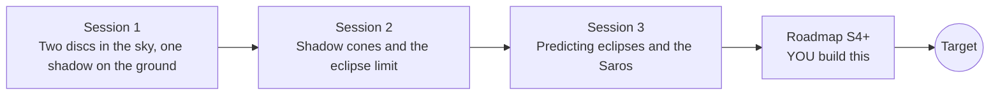

# openeclipse

[](https://github.com/KrunalPanchal1995/openeclipse/actions/workflows/ci.yml)   [](https://colab.research.google.com/github/KrunalPanchal1995/openeclipse/blob/main/sessions/session-01/lesson.ipynb) [](https://krunalpanchal1995.github.io/openeclipse/)

**Predict when and where the Moon hides the Sun, in three sessions.**

openeclipse teaches how eclipses work: the Moon's shadow cones, the node condition, and a small prediction engine that rediscovers the 18-year Saros cycle, using only Python and a browser.

- **Start from zero.** Session 1 needs only school trigonometry; no astronomy background is assumed.
- **See it move.** Every session ships a slider app that runs in the browser, with labelled graphs.
- **Know you got it right.** Each session ends with a checkpoint that prints PASS or FAIL against hand calculations and published eclipses.
- **Build the missing half.** The repo stops at Session 3 on purpose; the roadmap shows the path to the Target.

[Target](#the-target) · [Who is this for](#who-is-this-for) · [Quick start](#quick-start) · [Sessions](#sessions) · [Roadmap](#roadmap) · [Contribute](#contribute) · [Explainer PDF](docs/explainer.pdf)

> **This repo is incomplete on purpose.** Sessions 1 to 3 are here and fully working. The finished Target below is a preview of what the community can build next. We show you the path, not the code. Sessions 4 and up are yours.

## The Target

An animated Sun, Moon and Earth with the Moon's shadow cones. The Moon slides down through the plane of the Earth's orbit (the node), the dark shadow lands on the Earth, and its footprint traces a track across a world outline as the Earth turns. Then the same eclipse repeats one Saros later, and its track appears about 116 degrees further west, again and again. Your goal over the coming sessions: build that footprint-and-Saros animation yourself. (Look at pictures of the Sun only through safe means; the animation is a drawing, not the real Sun.)


*Target: the Moon crosses its node, the umbra footprint crosses a world outline, and the Saros repeats 116 degrees further west*


*Target still: shadow cones, the footprint and two Saros repeats*

Try it live:

- [Math Visual Studio: open the Studio](https://krunalpanchal1995.github.io/studio/)

How the Target was made is shown only as a path in [promo/roadmap.md](promo/roadmap.md).

## Who is this for
**secondary school to diploma / undergraduate (levels 3-5).** Topic area: Astronomy and Space Science.

Prerequisites:

- Sine, cosine and tangent of an angle (school trigonometry); similar triangles.
- Python 3.10 or newer; if `python --version` works, you are ready. PRIMER.md explains the rest.
- No prior GitHub or astronomy experience is needed. Safety: never look at the Sun without certified eclipse glasses.

New to Python? Read [PRIMER.md](PRIMER.md) first (10 minutes).

## Quick start

No installation knowledge needed. You need [Git](https://git-scm.com/downloads) and [Python 3.10+](https://www.python.org/downloads/) (Windows: tick "Add Python to PATH"). On Mac and Linux type `python3` wherever this page says `python`.

```bash
git clone https://github.com/KrunalPanchal1995/openeclipse.git
cd openeclipse
python start.py 1
```

`start.py` creates a private environment, installs what is needed and runs Session 1 with its checkpoint. Next: `python start.py 2`, `python start.py 3`, or `python start.py test` to check everything. Only a checkpoint: `python start.py check 1`.

Four lines turn the idea of Session 2 into a result (they work as they are): Save it as `try.py` and run it with `python start.py run try.py` (this uses the private environment, where NumPy is installed):

```python
import numpy as np
R, r, D = 696000.0, 1737.0, 1.496e8          # Sun radius, Moon radius, Sun-Moon distance (km)
L = D * r / (R - r)                           # length of the Moon's dark shadow cone
print(round(L), 'km')                         # -> 374289 km, a little short of the Moon-Earth distance 384400 km
```

Every session also opens in your browser with sliders (no install): [live apps](https://krunalpanchal1995.github.io/openeclipse/). Or use the Colab badge above for the notebook.

## Sessions

| # | Session | Model level | Time | Live app |
|---|---|---|---|---|
| 1 | [Two discs in the sky, one shadow on the ground](sessions/session-01/README.md) | Level 1: conceptual interactive model | 60 min | [open](https://krunalpanchal1995.github.io/openeclipse/session-01/) |
| 2 | [Shadow cones and the eclipse limit](sessions/session-02/README.md) | Level 2: mathematical engineering model | 75 min | [open](https://krunalpanchal1995.github.io/openeclipse/session-02/) |
| 3 | [Predicting eclipses and the Saros](sessions/session-03/README.md) | Level 3: simulation and validation | 90 min | [open](https://krunalpanchal1995.github.io/openeclipse/session-03/) |

Each session follows the same six steps: A real-world problem, B concept and theory, C visual explanation, D interactive simulation, E worked example and experiment, F assessment and design challenge. Each ends with `checkpoint.py`, which prints `PASS` or `FAIL` against reference numbers. Session 3 also contains the real-world mini-project: **Which new moons in 2027 to 2029 can give a solar eclipse?**.

## Architecture



| Folder or file | What is inside |
|---|---|
| `sessions/` | three sessions: README (A-F), `lesson.py`, notebook, live app, exercises, activity sheet, checkpoint |
| `promo/` | the Target: media, live links, and the roadmap (path only) |
| `docs/` | `explainer.tex` and the built `explainer.pdf` |
| `tests/` | runs every lesson and checkpoint headless |
| `start.py` | one command to set up and run anything |
| `QUALITY.md`, `RUBRIC.md` | the quality checklist and the scoring rubric |
| `.github/` | CI, PDF build, Pages deploy, issue and PR templates |

## Roadmap

| Milestone | What you will build | Difficulty |
|---|---|---|
| Session 4: Minute-level timing | A longer series for the new moon time and the Moon's latitude, checked against published eclipses. | intermediate |
| Session 5: Every type right | An improved classifier for total, hybrid, annular and partial eclipses. | intermediate |
| Session 6: The footprint on a rotating Earth | A simulation of the umbra footprint for one eclipse, drawn on a world outline. | advanced |
| Session 7: Build a whole Saros series | A listing of every member of one series with its type, gamma and magnitude. | advanced |
| Session 8: Lunar eclipses as the other half | A predictor for lunar eclipses in the same 3-year window. | advanced |

Full detail with a checkpoint per milestone: [promo/roadmap.md](promo/roadmap.md).

## Contribute
New to GitHub? Read [CONTRIBUTING.md](CONTRIBUTING.md); it starts from zero. Pick an issue labelled `good first issue`. Translations into Hindi, Telugu, Tamil and Malayalam are welcome.

<details>
<summary>Development</summary>

```bash
python start.py test        # runs every lesson and checkpoint
```
Lessons use `# %%` cell markers so they open as notebooks in VS Code. See [QUALITY.md](QUALITY.md) for the standard every session meets.
</details>

## License
MIT. See [LICENSE](LICENSE). Media in `promo/media` is (c) Krunal Panchal, CC BY 4.0.

## Acknowledgments
Part of the [PAN IIT OSS](https://hellofoss.tech-iitb.org/projects) open-source teaching collection, modelled on the structure of [openspline](https://github.com/openspline/openspline). Built on ideas from the Math Visual Studio at https://krunalpanchal1995.github.io/studio/.
