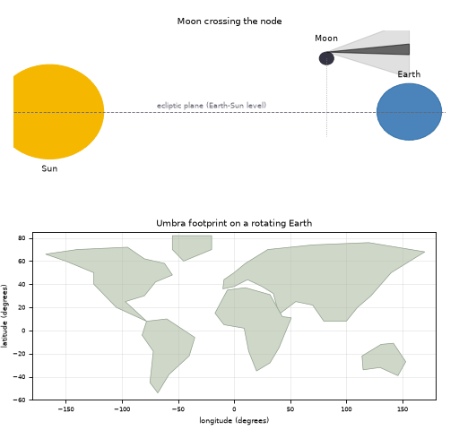
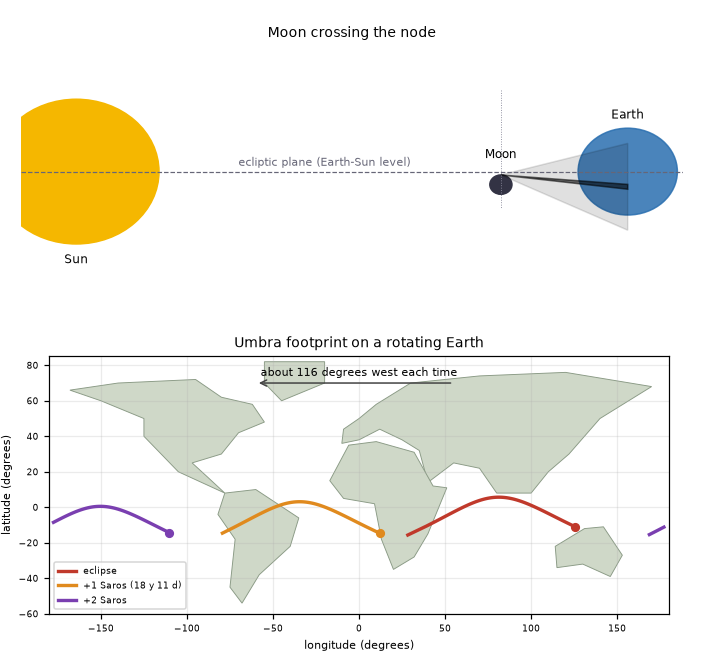

# What you are building toward

An animated Sun, Moon and Earth with the Moon's shadow cones. The Moon slides down through the plane of the Earth's orbit (the node), the dark shadow lands on the Earth, and its footprint traces a track across a world outline as the Earth turns. Then the same eclipse repeats one Saros later, and its track appears about 116 degrees further west, again and again. Your goal over the coming sessions: build that footprint-and-Saros animation yourself. (Look at pictures of the Sun only through safe means; the animation is a drawing, not the real Sun.)

*Target: the Moon crosses its node, the umbra footprint crosses a world outline, and the Saros repeats 116 degrees further west*

*Target still: shadow cones, the footprint and two Saros repeats*

These results come from a private reference build. The code is not published; the roadmap shows the path so you can build your own.

Live links:

- [Math Visual Studio: open the Studio](https://krunalpanchal1995.github.io/studio/)
