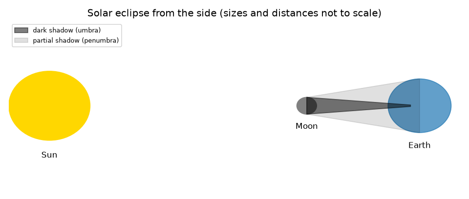
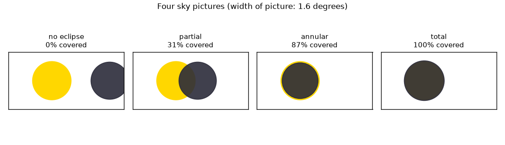

# Session 1: Two discs in the sky, one shadow on the ground

*Level 1 (conceptual interactive model) · about 60 minutes · openeclipse*

> This is a simplified educational model. It is not a validated design tool and must not be used for real structures, electrical installations, vehicles, industrial processes or medical decisions.

**Prerequisites**

- School trigonometry: the tangent of an angle.
- You have read PRIMER.md and run `python start.py 1` once.
- Safety: you never need to look at the Sun for this repo.

**Learning objectives.** After this session you can:

- Describe a solar eclipse (the Moon's shadow falls on the Earth) and a lunar eclipse (the Moon enters the Earth's shadow).
- Compute how big the Sun and Moon look in the sky and see that they are almost equal.
- Decide partial, total or annular from how well the two discs line up.
- Find the Moon distance that separates total from annular eclipses.

## A. Real-world problem
Once or twice a year, somewhere on Earth, the daytime sky goes dark for a few minutes. The Sun is about 400 times wider than the Moon, so how can the Moon hide it completely? And why does it happen only along a thin track on the ground? SAFETY: looking at the Sun without certified eclipse glasses damages eyes, even when the Sun is mostly covered. Everything in this repo is calculation; you never need to look at the Sun. Health note: this is general education only.

## B. Concept and theory
A solar eclipse happens when the Moon passes between the Sun and the Earth, so the Moon's shadow sweeps across the ground. A lunar eclipse happens when the Moon passes into the Earth's shadow. What decides the sight is the angular size of each disc: a ball of radius r at distance d spans an angle with tan(angle) = r/d. The Sun is 400.7 times wider than the Moon but 389.2 times farther away, so both look about 0.5 degrees wide: 0.533 degrees for the Sun and 0.518 degrees for the Moon at its mean distance. Call the angular radii rs (Sun) and rm (Moon) and the distance between the two disc centres sep. If sep is at least rs + rm there is no eclipse; if the Moon is the bigger disc and sep is at most rm - rs the Sun is totally hidden; if the Moon is the smaller disc and sep is at most rs - rm a bright ring is left (annular); anything between is partial. The Moon is bigger than the Sun only when it is nearer than 373,355 km.

| Symbol | Meaning | Unit |
|---|---|---|
| r | radius of the Sun or Moon (696000 km, 1737 km) | km |
| d | distance to the Sun or Moon | km |
| rs, rm | angular radius of the Sun, of the Moon | degrees |
| sep | angular distance between the two centres | degrees |
| v | orbital speed of the Moon (1.023 km/s) | km/s |

**Assumptions**

- The Sun and Moon are spheres seen from the centre of the Earth.
- The Sun is 1.496e8 km away and the Moon 384400 km away unless stated.
- Angles are small, so discs are drawn as circles in a flat sky picture.

$$ \tan\alpha=\frac{r}{d} $$

$$ \text{total: } r_m\ge r_s \text{ and } \mathrm{sep}\le r_m-r_s;\qquad \text{annular: } r_s>r_m \text{ and } \mathrm{sep}\le r_s-r_m $$

$$ d_{\mathrm{crit}}=\frac{R_{\mathrm{Moon}}}{\tan r_s} $$

## C. Visual explanation
The first figure draws the Sun, Moon and Earth from the side with the dark shadow (umbra) and the partial shadow (penumbra); it is not to scale. The second figure shows four sky pictures with the same 1.6 degree frame: no eclipse, a partial eclipse (31 percent of the Sun's area covered), an annular eclipse at 400000 km (87.1 percent) and a total eclipse at 360000 km (100 percent).

*Solar eclipse from the side (not to scale): dark umbra and partial shadow.*

*Four sky pictures: no eclipse, partial, annular and total.*

## D. Interactive simulation
Run the lesson (`python start.py 1`), then open the live app: [Session 1: two discs in the sky](https://krunalpanchal1995.github.io/openeclipse/session-01/) (or `app.html` in this folder). Slide the centre distance and the Moon distance and watch the discs; switch to the graph to see the covered fraction against distance between the centres.

**Challenge.** Make a total eclipse: choose a Moon distance and an alignment that hide the whole Sun.

## E. Worked example and experiment
**Problem.** The Moon is at its mean distance 384400 km and its centre is 0.30 degrees from the centre of the Sun. What kind of eclipse is this and how much of the Sun's area is hidden?

1. Sun: rs = arctan(696000 / 1.496e8) = 0.2666 degrees. Moon: rm = arctan(1737 / 384400) = 0.259 degrees.
2. rs + rm = 0.525 degrees. Since sep = 0.30 is smaller than that, the discs overlap: an eclipse of some kind.
3. rm is smaller than rs and sep is larger than rs - rm = 0.008 degrees, so the Sun is not fully hidden and no ring forms: partial.
4. The overlap of two circles gives a covered fraction of 0.306 of the Sun's area (about 31 percent).

**Answer.** A partial eclipse with about 31 percent of the Sun's area covered.

**Experiment.** Hold a coin at arm's length and compare it with the Moon's width on a night when the Moon is up (never do this with the Sun): a 20 mm coin at 2.3 m looks 0.5 degrees wide; many people are surprised how small the Moon is. Model versus reality: the model uses perfect spheres and a centre-of-the-Earth observer, while a real observer is up to 6378 km from the centre, which shifts the discs by up to about 1 degree. Session 2 includes that.

## F. Assessment and design challenge
**Question type A: Conceptual.** The Sun is about 400 times wider than the Moon. Why can the Moon still hide it?

Hint

Compare the ratio of the diameters with the ratio of the distances.

Step-by-step solution

The apparent size depends on size divided by distance. The diameter ratio is 400.7 and the distance ratio is 389.2, almost the same, so the two discs look about equally wide: 0.533 degrees and 0.518 degrees. Because the Moon's distance varies, it is sometimes slightly bigger than the Sun (total eclipse) and sometimes slightly smaller (annular).

**Question type B: Numerical.** The Moon is at 400000 km with its centre exactly on the Sun's centre. Find rm and the fraction of the Sun's area covered.

Hint

rm = arctan(1737 / d); if the smaller disc sits fully inside the larger one, the fraction is (small radius / large radius) squared.

Step-by-step solution

rm = arctan(1737 / 400000) = 0.2488 degrees. Since rm is smaller than rs = 0.2666 the Moon sits inside the Sun's disc: annular. Covered fraction = (0.2488 / 0.2666)^2 = 0.871, so 87.1 percent. Sanity check: it is below 100 percent, as a ring of Sun remains.

**Question type C: Graph and simulation interpretation.** On the graph of covered fraction against centre distance for the mean Moon, at about what distance does the curve reach zero? Why is the curve 'flat' at the left end for a Moon at 360000 km?

Hint

Use the sum of angular radii; for the second part compare rm - rs with the flat stretch.

Step-by-step solution

It reaches zero at sep = rs + rm = 0.525 degrees, when the edges just touch. For a Moon at 360000 km the Moon is bigger than the Sun by 0.0099 degrees, so for any sep from 0 up to 0.0099 degrees the whole Sun is hidden and the curve stays at 1 (100 percent).

**Question type D: Design and optimisation challenge.** Design: a photographer wants a total eclipse from a spot where the discs line up exactly. What condition must the Moon's distance satisfy, and how well must the discs be aligned if the Moon is at 360000 km?

Hint

Total needs rm at least rs; then sep must not exceed rm - rs.

Step-by-step solution

The Moon must be nearer than 373,355 km, so that rm is at least rs. At 360000 km, rm - rs = 0.0099 degrees, so the centres must be within 0.0099 degrees of each other. Trade-off: a closer Moon gives a larger margin, so the total phase is longer and the track wider (Session 2).

Score yourself with [RUBRIC.md](../../RUBRIC.md). Print the [activity sheet](activity_sheet.md) to work on paper.

## Common misconceptions
| Common misconception | What is actually true |
|---|---|
| The Moon covers the Sun because it is the same size. | The Moon is about 400 times smaller; it is also about 389 times nearer, so it looks the same size in the sky. |
| Every total eclipse looks the same. | At a farther Moon (below 373,355 km is needed for total) the Moon is too small and leaves a ring: an annular eclipse. |
| A partial eclipse is safe to look at. | Never look at the Sun without certified eclipse glasses, even when most of it is covered. |
| A lunar eclipse and a solar eclipse are the same thing seen from different places. | In a solar eclipse the Moon's shadow falls on the Earth; in a lunar eclipse the Moon is inside the Earth's shadow, and everyone on the night side sees it. |

## Glossary
- **angular size**: the angle a disc covers in the sky, in degrees
- **umbra**: the darkest part of a shadow, where the Sun is fully hidden
- **penumbra**: the lighter part of a shadow, where the Sun is partly hidden
- **annular eclipse**: an eclipse where a bright ring of the Sun is left around the Moon
- **totality**: the time during which the Sun is completely hidden

## Finish
1. Do the three coding tasks in [exercises.md](exercises.md).
2. Run `python start.py 1` again after your changes. It ends with the checkpoint; when it prints `PASS`, you are done. (Checkpoint only: `python start.py check 1`.)

Next: [Session 2](../session-02/README.md)
