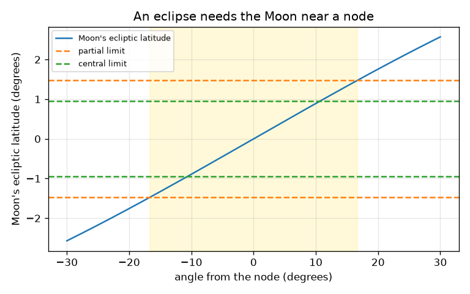
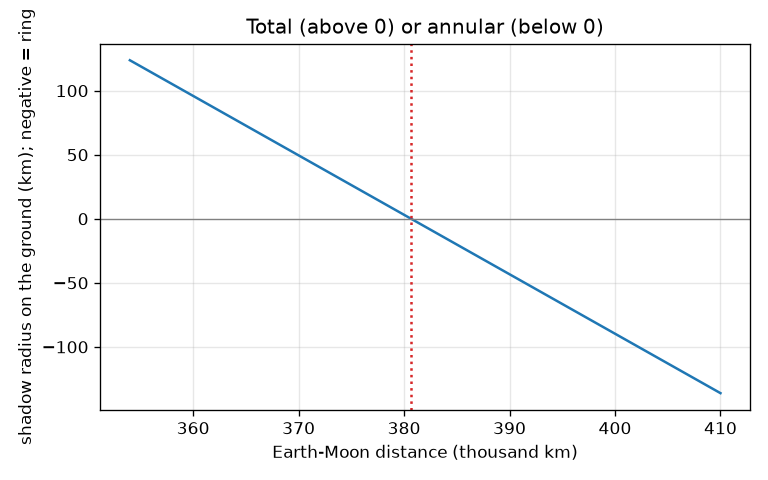

# Session 2: Shadow cones and the eclipse limit

*Level 2 (mathematical engineering model) · about 75 minutes · openeclipse*

> This is a simplified educational model. It is not a validated design tool and must not be used for real structures, electrical installations, vehicles, industrial processes or medical decisions.

**Prerequisites**

- Session 1: angular size and the three eclipse types.
- Similar triangles and the inverse sine function.

**Learning objectives.** After this session you can:

- Derive the length of the Moon's umbra by similar triangles and compute it.
- Explain, with numbers, why eclipses are total when the Moon is close and annular when it is far.
- Compute the width of the path of totality and the radius of the penumbra.
- Derive the eclipse limit near the Moon's node and the length of an eclipse season.

## A. Real-world problem
Why is a total solar eclipse so rare at any one place, and why is there not an eclipse every month? The Moon's dark shadow is a thin cone whose tip only just reaches the Earth, and the Moon's orbit is tilted, so most new moons pass above or below the Sun. SAFETY: never look at the Sun without certified eclipse glasses. This is general education and simplified geometry, not a tool for planning where to stand.

## B. Concept and theory
Let R and r be the Sun's and Moon's radii and D the Sun-Moon distance. Draw the line from the top of the Sun to the top of the Moon and continue it to the axis: the tip of the dark cone, at distance L behind the Moon. The small triangle (tip to Moon) and the big triangle (tip to Sun) are similar, so r/L = R/(L + D), which gives L = D r / (R - r) = 374,289 km. That is 10,111 km short of the mean Earth-Moon distance 384,400 km: at the mean distance the tip falls short of the ground (which starts 378,022 km from the Moon) and the eclipse is annular. The dark circle on the ground has radius r (L - s)/L at distance s behind the Moon; negative means beyond the tip (the ring region, the antumbra). It is positive only if the Earth-Moon distance is below L + 6378 = 380,667 km. At perigee, 356500 km, the dark path is 224 km wide. The penumbra radius at the ground is 3500 km. The Moon's orbit is tilted by i = 5.145 degrees to the ecliptic, so its ecliptic latitude at angle u from the node is sin(beta) = sin(i) sin(u). A partial eclipse needs |beta| below pi + rs + rm, where pi (0.951 degrees at the mean distance) is the parallax of the Moon; the limit is 1.476 degrees, giving u up to 16.7 degrees. A central eclipse needs |beta| below pi, giving 10.7 degrees. With the extremes of distance and tilt the partial limit reaches 18.4 degrees, is certain within 15.4 degrees, and the central limit reaches 11.8 degrees. The Sun passes a node twice per draconic year of 346.62 days, so eclipse seasons are 173.31 days apart.

| Symbol | Meaning | Unit |
|---|---|---|
| R, r | radius of the Sun, of the Moon (696000, 1737) | km |
| D | Sun-Moon distance (1.496e8) | km |
| L | length of the umbra behind the Moon | km |
| s | distance behind the Moon | km |
| d | Earth-Moon distance | km |
| i | tilt of the Moon's orbit (5.145) | degrees |
| u | angle from the node along the orbit | degrees |
| beta | ecliptic latitude of the Moon | degrees |
| pi | parallax of the Moon, arcsin(6378 / d) | degrees |

**Assumptions**

- Spheres, and the Sun-Moon distance taken as 1.496e8 km (error under 0.3 percent).
- The ground is treated as flat and facing the Moon; the real path is wider when the Sun is low.
- The Sun is on the ecliptic at new moon; the node limit uses the argument of latitude and ignores the small difference from longitude.
- Educational approximation, not for planning real observations.

$$ L=\frac{D\,r}{R-r} $$

$$ \rho_{\mathrm{umbra}}(s)=r\,\frac{L-s}{L},\qquad \rho_{\mathrm{penumbra}}(s)=r+s\,\frac{R+r}{D} $$

$$ |\beta|<\pi+s_{\odot}+s_{\mathrm{M}},\qquad \sin\beta=\sin i\,\sin u $$

$$ u_{\mathrm{limit}}=\arcsin\!\left(\frac{\sin\beta_{\mathrm{limit}}}{\sin i}\right) $$

$$ T_{\mathrm{season}}=\frac{2u_{\mathrm{limit}}}{360^\circ/346.62\ \mathrm{d}} $$

## C. Visual explanation
The first figure plots the radius of the dark shadow on the ground against the Moon's distance: it falls straight through zero at 380,667 km. Above the line a total eclipse, below it a ring. The second figure shows the Moon's ecliptic latitude against the angle from the node, with the partial limit (1.476 degrees) and the central limit (0.951 degrees): the Moon is inside the limits only for a short stretch of orbit on each side of the node.

*The Moon's ecliptic latitude against the angle from the node, with the partial and central limits.*

*Radius of the dark shadow on the ground against the Moon's distance.*

## D. Interactive simulation
Run the lesson (`python start.py 2`), then open the live app: [Session 2: the shadow cone](https://krunalpanchal1995.github.io/openeclipse/session-02/) (or `app.html` in this folder). Move the Moon distance and the Sun distance and watch the tip of the dark cone move relative to the Earth, then switch to the graph to see the radius change sign.

**Challenge.** Make a total eclipse whose dark path is at least 150 km wide.

## E. Worked example and experiment
**Problem.** The Moon is at perigee, 356500 km from the Earth. How wide is the path of totality, and how long does totality last at the equator?

1. Umbra length: L = 1.496e8 * 1737 / (696000 - 1737) = 374,289 km.
2. The nearest ground is s = 356500 - 6378 = 350,122 km behind the Moon, which is less than L, so the eclipse is total.
3. Dark radius: 1737 * (374289 - 350122) / 374289 = 112.2 km, so the path is 224.3 km wide.
4. Shadow speed over the equator ground = 2 pi d / T minus 0.465 km/s = 0.949 - 0.465 = 0.484 km/s.
5. Duration = 224.3 km / 0.484 km/s = 463 s = 7.7 minutes.

**Answer.** The path is about 224 km wide and totality lasts about 7.7 minutes at most.

**Experiment.** Compare with a published eclipse path (the NASA eclipse website lists path width and central duration for every total eclipse) and also hold a torch above a ball and a smaller ball to see the cone and penumbra. Real paths are usually narrower than 224 km because the Moon is rarely at perigee and the Sun is often not overhead, and the model ignores the tilt of the ground, which makes the real track wider when the Sun is low. Model versus reality: the model gives the right scale (a few hundred km) but not the exact number for any one eclipse.

## F. Assessment and design challenge
**Question type A: Conceptual.** At the mean Moon distance the discs look almost equal. Why is an eclipse at the mean distance annular, not total?

Hint

Compare the umbra length with the distance from the Moon to the nearest ground.

Step-by-step solution

The umbra is L = 374,289 km long, but the nearest ground is 378,022 km behind the Moon, so the tip stops 3,733 km short of the ground and the observer is inside the antumbra, seeing a ring. A total eclipse needs the Moon nearer than 380,667 km, which happens near perigee.

**Question type B: Numerical.** Compute the umbra length for R = 696000 km, r = 1737 km, D = 1.496e8 km and compare it with 384400 km.

Hint

L = D r / (R - r).

Step-by-step solution

L = 1.496e8 * 1737 / 694263 = 374,289 km, about 3.7e5 km. It is 10,111 km shorter than 384400 km. Units: kilometres, same as the inputs.

**Question type C: Graph and simulation interpretation.** On the graph of dark-shadow radius against Earth-Moon distance, where does the curve cross zero, and what does a negative value mean?

Hint

The crossing is where the tip just touches the ground.

Step-by-step solution

It crosses zero at 380,667 km (L + 6378 km). Below that the radius is positive: total eclipse. Above it the value is negative: the ground is beyond the tip, inside the antumbra, and the eclipse is annular; the magnitude is the radius of the ring region (17.3 km radius at the mean distance, so 34.6 km wide).

**Question type D: Design and optimisation challenge.** Design: how large a limit angle must we assume so that every eclipse season is certain to contain at least one new moon within the limit? Compare 15.4 degrees with the synodic month.

Hint

Season length = 2 limit / (360 / 346.62) days; compare with 29.53 days.

Step-by-step solution

With the certain limit 15.4 degrees the season lasts 29.65 days, a little longer than the 29.53 day synodic month, so at least one new moon falls in every season. With the mean limit 16.7 degrees the season is 32.1 days, so sometimes two new moons fit. Trade-off: a larger limit gives a longer season but also includes eclipses that are tiny partials.

Score yourself with [RUBRIC.md](../../RUBRIC.md). Print the [activity sheet](activity_sheet.md) to work on paper.

## Common misconceptions
| Common misconception | What is actually true |
|---|---|
| Eclipses happen every month because the Moon passes the Sun every month. | The Moon's orbit is tilted by 5.145 degrees, so it usually passes above or below the Sun; only near a node is an eclipse possible. |
| A total eclipse is visible from half the Earth. | The dark cone makes a path only about 224 km wide at most in the model, and the partial shadow about 7000 km wide. |
| The Moon always covers the Sun because the umbra is longer than the Moon's distance. | The umbra is 374,289 km long and the Moon is on average 384,400 km away, so the tip usually falls short of the ground. |
| The node limit is the same every time. | It depends on the distance of the Moon and Sun and the tilt: the partial limit runs from about 15.4 (certain) to 18.4 degrees (possible). |

## Glossary
- **umbra**: the cone of full shadow behind the Moon
- **antumbra**: the region beyond the tip of the umbra where a ring of Sun is seen
- **node**: the point where the Moon's orbit crosses the ecliptic
- **parallax**: the shift in apparent position caused by the observer's position on the Earth
- **eclipse season**: the weeks when the Sun is close enough to a node for eclipses
- **draconic year**: 346.62 days, the time for the Sun to return to the same node

## Finish
1. Do the three coding tasks in [exercises.md](exercises.md).
2. Run `python start.py 2` again after your changes. It ends with the checkpoint; when it prints `PASS`, you are done. (Checkpoint only: `python start.py check 2`.)

Next: [Session 3](../session-03/README.md)
