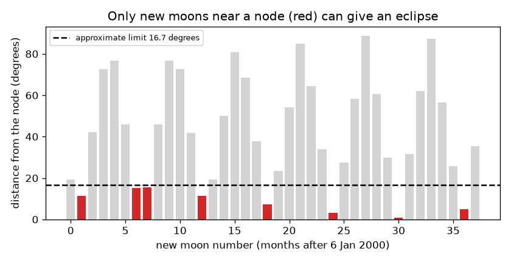
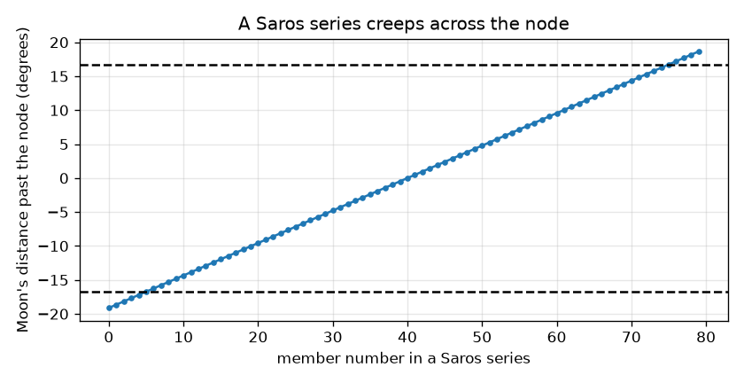

# Session 3: Predicting eclipses and the Saros

*Level 3 (simulation and validation) · about 90 minutes · openeclipse*

> This is a simplified educational model. It is not a validated design tool and must not be used for real structures, electrical installations, vehicles, industrial processes or medical decisions.

**Prerequisites**

- Session 1 and Session 2.
- Comfort with angles in degrees and radians, and with Python lists.

**Learning objectives.** After this session you can:

- Build a small eclipse predictor from mean motions of the Sun and Moon plus a few large corrections.
- Validate the predictor against published eclipse times and gamma values and report its errors.
- Show that 223 synodic months, 242 draconic months and 239 anomalistic months are nearly equal, and explain the 18-year Saros shift.
- Produce an honest, labelled eclipse list for a three-year window and name the model's failure cases.

## A. Real-world problem
Ancient astronomers predicted eclipses without computers: after about 18 years the Sun, Moon and node return to nearly the same arrangement, so eclipses repeat. Can we rediscover that cycle with a few lines of Python, and predict which new moons in the next years give an eclipse? EDUCATIONAL APPROXIMATION: our model is accurate to hours in time and sometimes wrong about the type; for real dates, times and maps use published eclipse tables. SAFETY: never look at the Sun without certified eclipse glasses.

## B. Concept and theory
Three angles run like clocks from one reference new moon (6 January 2000): the Sun's anomaly M, the Moon's anomaly M' and the Moon's argument of latitude F (angle from the ascending node). Each advances by 360 times the synodic month divided by the period of the clock. The mean new moon time is JD0 + k * 29.530589 days, and seven correction terms (up to 0.4 days) fix the largest wobbles. The Moon's latitude beta comes from F and M' with a short series, its distance from M', and gamma = d sin|beta| / R_Earth is the distance of the shadow axis from the Earth's centre in Earth radii. A partial eclipse needs gamma below 1 plus the penumbra radius in Earth radii; a central one needs gamma below 1. Using only the mean motions, the predicted times are wrong by up to 12.7 hours; with the corrections, every one of 13 published eclipses is within 0.2 hours. 223 synodic months are 6585.32 days; 242 draconic months are 6585.36 days and 239 anomalistic months are 6585.54 days: nearly equal. So after 223 new moons (the Saros, 18 years 11 days 7.7 hours when 4 leap days fall in the 18 years) the Moon is again near the same node and the same distance. The extra 0.32 day turns the Earth by 115.7 degrees, so the track moves about 120 degrees west. One Saros moves the Moon 0.478 degrees along its orbit relative to the node, so a series lasts about 69 repeats.

| Symbol | Meaning | Unit |
|---|---|---|
| k | number of the new moon after 6 January 2000 | no unit |
| M, M', F | Sun anomaly, Moon anomaly, Moon argument of latitude | degrees |
| beta | ecliptic latitude of the Moon at new moon | degrees |
| gamma | distance of the shadow axis from the Earth's centre | Earth radii |
| T_syn, T_dra, T_ano | synodic, draconic, anomalistic month (29.530589, 27.212221, 27.554550) | days |
| magnitude | fraction of the Sun's diameter covered at the best place | no unit |

**Assumptions**

- Mean motions plus the largest periodic terms only: the result is good to hours.
- The ground is a sphere of radius 6378 km; the Earth's flattening and the shape of the path are ignored.
- Times are Universal Time; the small difference between time scales is ignored.
- Educational approximation, not an official prediction.

$$ F_k=F_0+k\,360^\circ\,\frac{T_{\mathrm{syn}}}{T_{\mathrm{dra}}}\ (\mathrm{mod}\ 360^\circ) $$

$$ \gamma=\frac{d\,\sin|\beta|}{R_{\oplus}} $$

$$ 223\,T_{\mathrm{syn}}\approx 242\,T_{\mathrm{dra}}\approx 239\,T_{\mathrm{ano}} $$

$$ \Delta\lambda_{\mathrm{track}}=360^\circ\times\left(223\,T_{\mathrm{syn}}\ \mathrm{mod}\ 1\ \mathrm{day}\right) $$

## C. Visual explanation
The first figure shows the distance from the nearest node of 38 successive new moons: bars below the dashed 16.7 degree line (red) are the new moons that can give an eclipse, and they come in groups about 173 days apart. The second shows one Saros series: the Moon's distance past the node grows by 0.478 degrees per member, so the series creeps from one side of the limit to the other over many repeats.

*Distance from the node for 38 new moons: red bars can give an eclipse.*

*A Saros series creeps across the node by 0.478 degrees per member.*

## D. Interactive simulation
Run the lesson (`python start.py 3`), then open the live app: [Session 3: eclipse seasons and the Saros](https://krunalpanchal1995.github.io/openeclipse/session-03/) (or `app.html` in this folder). Change the starting phase and the eclipse limit and count how many of 36 new moons fall in eclipse seasons; then raise the number of Saros repeats and watch the track move west by 115.7 degrees each time.

**Challenge.** After how many Saros repeats does the track come back to within 15 degrees of its starting longitude?

## E. Worked example and experiment
**Problem.** Predict the new moon of the total eclipse of 8 April 2024 and compare it with the published greatest-eclipse time of 18:17 UT.

1. The nearest new moon number is k = 300. Mean time: 2451550.09766 + 300 * 29.530589 days = 8 April 2024 18:35 UT.
2. The seven correction terms add -12.4 minutes, giving 18:22 UT. The published time is 18:17 UT: the prediction is within 6 minutes.
3. The argument of latitude at that moment gives a distance from the node of 1.9 degrees, far inside the limit of 16.7 degrees.
4. The latitude series gives beta = 0.36 degrees and the Moon distance 359,808 km, so gamma = 0.35 (below 1: central).
5. The umbra is longer than the Moon distance, so the predicted type is total.

**Answer.** A total eclipse at about 18:22 UT, 6 minutes from the published time, with gamma 0.35.

**Experiment.** Compare every prediction in the table with a published eclipse list (the NASA eclipse website lists date, type, gamma and magnitude). In our table all 13 times agree within 0.2 hours, all gamma values within 0.04 Earth radii, and the type is right for 11 of 13. Model versus reality: the real eclipse needs hundreds of terms in the Moon's motion; our short series are why the model is only good to hours, and why borderline types (a hybrid, or an annular eclipse with gamma near 1) are called wrongly.

## Real-world application and mini-project: Which new moons in 2027 to 2029 can give a solar eclipse?
Use the Session 3 functions to list every new moon from 1 January 2027 to 31 December 2029 that falls in an eclipse season, with the predicted type (partial, annular, total) and gamma. This is an educational approximation, accurate to hours in time and sometimes wrong about the type: label your table that way, and tell the reader to check published eclipse tables (for example the NASA eclipse website) for real dates, times and maps. Safety: never look at the Sun without certified eclipse glasses.

**Deliverable:** A script that prints one row per eclipse (date, predicted type, gamma, magnitude), counts how many are total, annular and partial, saves a bar chart of the distance from the node for every new moon in the window, and ends with a note about the approximation and where to find published tables.

**Success looks like:** The table has 8 rows: 2 total, 2 annular and 4 partial, the first on 2027-02-06 (annular) and the last on 2029-12-05 (partial), and the note about the approximation is printed.

## F. Assessment and design challenge
**Question type A: Conceptual.** Why does using only the mean motion give an error of up to 12.7 hours in the time of new moon?

Hint

Think about what a 'mean' motion leaves out: the Moon and the Earth do not move at constant speed.

Step-by-step solution

The Moon speeds up near perigee and slows near apogee, and the Earth speeds up near perihelion, so the real new moon is ahead of or behind the evenly spaced mean new moon by up to about half a day. The seven correction terms (dominated by -0.4072 sin M') capture most of this, bringing the error down to 0.2 hours for our 13 test eclipses.

**Question type B: Numerical.** Compute 223 synodic months and 242 draconic months in days with the stated mean periods. How far apart are they?

Hint

Multiply and subtract.

Step-by-step solution

223 * 29.530589 = 6585.32 days and 242 * 27.212221 = 6585.36 days. They differ by 0.036 days (about 52 minutes). The anomalistic count 239 * 27.554550 = 6585.54 days is 0.216 days (5 hours) away. All three agree to within a fraction of a day.

**Question type C: Graph and simulation interpretation.** In the Saros-series figure, how many degrees does the Moon move past the node per member, and about how many members does a series have inside the 16.7 degree limit?

Hint

Count how many steps of the drift fit into the width of the window, 2 * 16.7 degrees.

Step-by-step solution

The drift is 0.478 degrees per Saros (from 360 * (223 T_syn / T_dra - 242)). The window is 33.4 degrees wide, and 33.4 / 0.478 = 69 members. Real series differ, because the limit depends on the Moon and Sun distance.

**Question type D: Design and optimisation challenge.** Design: you want to find an eclipse whose track returns to nearly the same longitude as an earlier one. Which multiple of the Saros should you use, how many years is it, and how close is the longitude?

Hint

One Saros shifts the track by 115.7 degrees west; find a multiple close to 360 degrees.

Step-by-step solution

Three Saros periods shift the track by 347.1 degrees, which is 12.9 degrees short of a full circle, so the track returns to within 13 degrees of the start. Three Saros periods are 19755.96 days, that is 54.09 years. Trade-off: longer spans repeat the same longitude but the series drifts out after about 69 repeats, so it is only usable within a series.

Score yourself with [RUBRIC.md](../../RUBRIC.md). Print the [activity sheet](activity_sheet.md) to work on paper.

## Common misconceptions
| Common misconception | What is actually true |
|---|---|
| The Saros repeats an eclipse in the same place. | The extra 0.32 day turns the Earth by about 116 degrees, so the track is about 120 degrees further west; only after three Saros periods (54 years) does it return to near the same longitude. |
| The Saros exactly repeats the Moon's geometry. | The three periods agree only to a fraction of a day, and the leftover moves the eclipse across the node, which is why every series ends. |
| A model good to hours can say which side of a boundary an eclipse falls on. | Near a boundary (annular versus partial, hybrid versus total) small errors flip the verdict; two of our 13 types are wrong. |
| Mean motion is enough for eclipse dates. | Mean motion alone is off by up to 12.7 hours here; the periodic terms matter. |

## Glossary
- **Saros**: 223 synodic months (about 18 years 11 days) after which eclipses repeat
- **synodic month**: new moon to new moon, 29.530589 days
- **draconic month**: node to the same node, 27.212221 days
- **anomalistic month**: perigee to perigee, 27.554550 days
- **gamma**: distance of the shadow axis from the Earth's centre in Earth radii
- **magnitude**: the fraction of the Sun's diameter covered at the best place

## Finish
1. Do the three coding tasks in [exercises.md](exercises.md).
2. Run `python start.py 3` again after your changes. It ends with the checkpoint; when it prints `PASS`, you are done. (Checkpoint only: `python start.py check 3`.)

Next: the [roadmap](../../promo/roadmap.md). Session 4 is yours to build.
